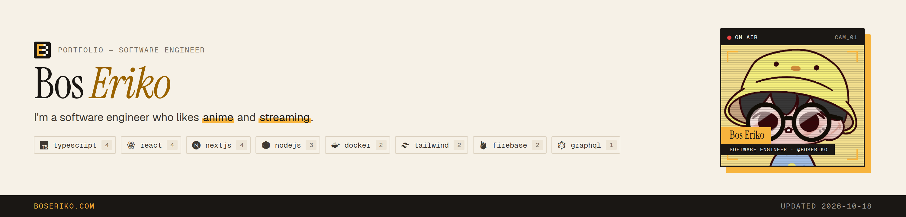

### Hey, I'm Bos Eriko

A software engineer who likes anime and streaming. See everything I build at **[boseriko.com](https://boseriko.com)** or read my **[resume](https://boseriko.com/resume)**.

#### Latest work

<table>
  <tr>
    <td width="33%" valign="top">
      
       PRODUCT
       <b><a href="https://github.com/BosEriko/life">life</a></b>
       A private all-in-one app for health, journaling, and personal finance. Track weight, water, food, blood pressure, and ha…
    </td>
    <td width="33%" valign="top">
      
       PROJECT
       <b><a href="https://github.com/BosEriko/boseriko.com">boseriko.com</a></b>
       Personal website and portfolio of Bos Eriko. Products, projects, and topics are pulled automatically from GitHub. Blog p…
    </td>
    <td width="33%" valign="top">
      
       PROJECT
       <b><a href="https://github.com/BosEriko/library">library</a></b>
       Search anime, manga and games from one place and open any title as a full profile. Every result shares the same schema a…
    </td>
  </tr>
</table>

#### Things I work with

&nbsp;&nbsp;
&nbsp;&nbsp;
&nbsp;&nbsp;
&nbsp;&nbsp;
&nbsp;&nbsp;
&nbsp;&nbsp;
&nbsp;&nbsp;

#### Open source

#### Connect

Updated weekly by GitHub Actions · 2026-10-18
